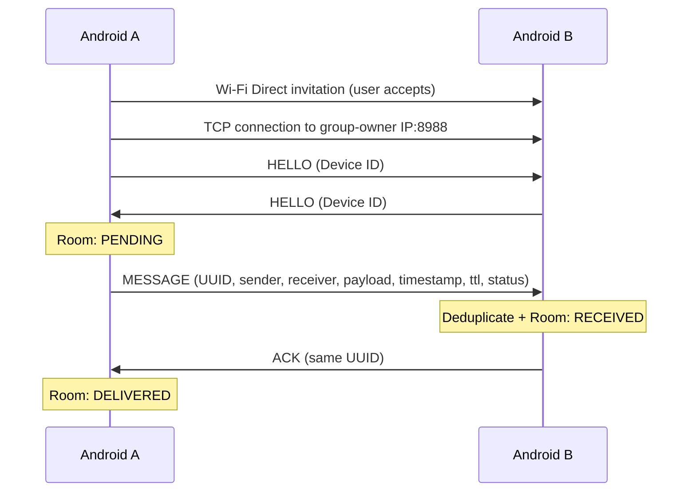

# Dinoblog — Group 16

แอป Android สำหรับวิชา Introduction to Computer Networking: ส่งข้อความโดยตรงระหว่างมือถือ **A ↔ B** ด้วย Wi-Fi Direct + TCP โดยไม่ต้องมี Internet, router, cloud, บัญชีผู้ใช้ หรือ server ภายนอก

## เปิดและ build โปรเจกต์

- Android Studio ที่รองรับ Android Gradle Plugin 8.11.1
- **JDK 17** (แนะนำ) หรือ JDK 21; Gradle 8.13 ไม่รองรับการรันด้วย JDK 25/26
- Android SDK Platform 36 และ Build Tools 35.0.0 (Gradle ติดตั้งได้เมื่อยอมรับ SDK licenses แล้ว)
- โทรศัพท์ Android 8.0 / API 26 ขึ้นไป 2 เครื่องที่รองรับ Wi-Fi Direct
- Internet จำเป็นเฉพาะการดาวน์โหลด build tools/dependencies ครั้งแรก ไม่จำเป็นเมื่อใช้แอป

1. เปิดโฟลเดอร์นี้ด้วย **Android Studio → Open**
2. ตั้ง **Settings → Build, Execution, Deployment → Build Tools → Gradle → Gradle JDK** เป็น JDK 17
3. ในเครื่องที่ใช้สร้างโปรเจกต์นี้ มี JDK แบบ portable ที่ `.tools/jdk-17.0.20.1+1` ให้เลือกได้ โดยไม่เปลี่ยน Java ของระบบ
4. ตรวจ `local.properties` ให้ชี้ Android SDK ของเครื่องคุณ (ไฟล์นี้ไม่ควร commit)
5. Gradle Sync แล้ว Run configuration `app` ลงโทรศัพท์

PowerShell ในโฟลเดอร์โปรเจกต์:

```powershell
# เลือก portable JDK ใน .tools โดยอัตโนมัติ หรือใช้ JAVA_HOME ที่ตั้งไว้
.\build.ps1

# หรือรันโดยตรง หลังตั้ง JAVA_HOME เป็นที่อยู่ JDK 17 ของคุณ
$env:JAVA_HOME = "$PWD\.tools\jdk-17.0.20.1+1"
.\gradlew.bat :app:assembleDebug :app:testDebugUnitTest :app:lintDebug :app:assembleDebugAndroidTest
```

macOS/Linux ใช้ JDK 17, แก้ SDK path แล้วรัน `bash ./gradlew :app:assembleDebug :app:testDebugUnitTest :app:lintDebug`

ไฟล์ติดตั้ง: `app/build/outputs/apk/debug/app-debug.apk`

## โครงสร้างและหน้าที่

```text
app/src/main/java/com/group16/dinoblog/
├── MainActivity.kt                 # Activity lifecycle และ Compose entry
├── DinoblogApplication.kt          # Dependency container ระดับ process
├── ui/
│   ├── DinoblogApp.kt              # Navigation และ permission launcher
│   ├── HomeScreen.kt               # Device ID, connection, conversations
│   ├── PeerDiscoveryScreen.kt      # Scan, connect, disconnect
│   ├── ChatScreen.kt               # ข้อความ, TTL, สถานะ, offline queue
│   ├── NetworkDebugScreen.kt       # IP, peer, packet logs, message IDs
│   ├── Components.kt
│   └── Theme.kt
├── viewmodel/AppViewModel.kt       # UI state และ user actions
├── model/                         # Message, MessageStatus, Peer, NetworkState
├── network/
│   ├── WifiDirectManager.kt       # Android P2P discovery/group lifecycle
│   ├── TcpTransport.kt            # Server/client, handshake, reconnect
│   ├── MessageTransport.kt        # Transport abstraction สำหรับ DTN/tests
│   └── WireProtocol.kt            # JSON packets + length-prefixed framing
├── dtn/DeliveryEngine.kt          # Store/retry, TTL, deduplication, ACK
├── database/                      # Room database, MessageDao, PeerDao, converters
├── repository/                    # MessageStore interface และ Room repository
└── util/                          # DeviceIdentity, Permissions, NetworkLogger
```

MVVM: Compose → ViewModel → DeliveryEngine/Repository → Room และ TCP transport; Wi-Fi Direct มีหน้าที่สร้างการเชื่อมต่อ local network ส่วน TCP ใช้รับส่งข้อมูลสองทิศทางบนการเชื่อมต่อนั้น

## ขั้นตอนทำงานของเครือข่าย

1. แต่ละเครื่องสร้าง UUID หนึ่งครั้ง เก็บใน SharedPreferences และคงอยู่เมื่อปิด/เปิดแอปหรือ restart เครื่อง
2. ค้นหา peer ด้วย Android Wi-Fi P2P API; ชื่อและ address ในหน้าค้นหายังไม่ใช่ Device ID ของแอป
3. ผู้ใช้เลือก Connect และยอมรับคำขอบนอีกเครื่อง Android เลือกว่าเครื่องไหนเป็น **group owner**
4. Group owner เปิด TCP server ที่ **P2P IP:8988** อีกเครื่องใช้ group-owner IP ที่ Android แจ้งมาสร้าง TCP client ไม่ hardcode `192.168.49.1`
5. ทั้งสองฝั่งส่ง `HELLO` เพื่อแลก persistent Device ID/ชื่อเครื่อง แล้วบันทึก peer ลง Room
6. ผู้ส่งบันทึกข้อความ `PENDING` ลง Room ก่อนส่ง `MESSAGE`
7. ผู้รับตรวจ sender/receiver, UUID, TTL และ duplicate; บันทึก `RECEIVED` ลง Room แล้วจึงส่ง `ACK`
8. ผู้ส่งเปลี่ยนเป็น `DELIVERED` เฉพาะ ACK ที่ messageId และ peer ตรงกับข้อความในฐานข้อมูล



แผนภาพย่อ TCP connection ให้เข้าใจง่าย; ในการใช้งานจริง A หรือ B ก็เป็น group owner ได้ และทั้งสองเครื่องส่งข้อความบน socket เดียวกันได้

### Protocol

- TCP stream ใช้ **length prefix 4 bytes, big-endian + UTF-8 JSON** จึงรับข้อความภาษาไทย, emoji, newline และ packet ที่ถูกแบ่ง/รวมระหว่างทางได้
- Protocol version `1`; packet types: `HELLO`, `MESSAGE`, `ACK`, `PING`, `PONG`
- ขนาด frame สูงสุด 64 KiB; payload สูงสุด 4,096 Kotlin characters (UTF-16 code units)
- `messageId`, `senderId`, `receiverId` เป็น UUID; `timestamp` เป็น Unix milliseconds
- `ttl` คือ **อายุข้อความเป็นวินาที** จาก timestamp; ค่าเริ่มต้น 86,400 (24 ชั่วโมง), ปรับได้ 1–604,800
- หมดอายุเมื่อ `now >= timestamp + ttl * 1000`; เก็บไว้เป็น `EXPIRED` เพื่อดูประวัติ แต่ไม่ส่งใหม่
- โทรศัพท์ทั้งคู่ควรตั้งวันเวลาให้ตรงกัน; ข้อความที่ลงเวลาอนาคตเกิน 5 นาทีจะถูกปฏิเสธ
- ส่ง heartbeat ทุก 10 วินาที; read timeout 35 วินาทีช่วยตรวจ socket ที่หลุด, handshake timeout 10 วินาที
- TCP client retry ทุก 2 วินาทีขณะที่กลุ่ม Wi-Fi Direct ยังอยู่; group owner รอ client กลับมา
- DTN ตรวจคิวทุก 5 วินาทีและทันทีเมื่อได้รับ Device ID ของ peer ที่เชื่อมต่อ
- ไม่มี multi-hop หรือการส่งข้อความของ B ผ่าน C

### ACK, duplicate และการคงข้อมูล

`PENDING` หมายถึงยังไม่ได้รับ ACK แม้ TCP write สำเร็จแล้ว ถ้า ACK หายจะส่งซ้ำด้วย **messageId เดิม** ผู้รับใช้ primary key ของ Room ป้องกันแถวซ้ำ และตอบ ACK ซ้ำให้ข้อความที่เคยบันทึกสำเร็จ

ข้อความที่เคยบันทึกแล้วจะถูก ACK ซ้ำได้แม้ TTL ผ่านไปแล้ว เพราะการส่งมาถึงสำเร็จก่อนหมดอายุ ACK ที่มาช้าจึงเปลี่ยน EXPIRED เป็น DELIVERED ได้ แต่ข้อความใหม่ที่หมดอายุจะไม่ถูกบันทึกหรือตอบ ACK

Device ID, peer history และข้อความอยู่ใน app-private storage; ปิด backup เพื่อป้องกันการนำ ID ไปใช้ซ้ำบนอีกเครื่อง การ **Clear storage / uninstall** จะลบข้อมูลและสร้าง Device ID ใหม่เมื่อติดตั้ง/เปิดอีกครั้ง

## ทดสอบด้วยมือถือจริงสองเครื่อง

### 1. เตรียม A และ B

1. ติดตั้ง APK เดียวกันทั้งสองเครื่องผ่าน Android Studio หรือ ADB:

   ```powershell
   adb devices
   adb -s SERIAL_A install -r app/build/outputs/apk/debug/app-debug.apk
   adb -s SERIAL_B install -r app/build/outputs/apk/debug/app-debug.apk
   ```

2. ปิด Mobile data และตัดการเชื่อมต่อ Wi-Fi Internet แต่ **เปิด Wi-Fi radio ไว้** ไม่ต้องเชื่อม router
3. ถ้าใช้ airplane mode ให้เปิด Wi-Fi กลับเอง และตรวจว่าเครื่องยังรองรับ Wi-Fi Direct ในโหมดนี้
4. เปิด Location ใน Android settings เพื่อช่วยให้ discovery ทำงานตามข้อกำหนดของ Android/ผู้ผลิต
5. เปิด Dinoblog ทั้งสองเครื่องและอนุญาต **Nearby devices** (Android 13+) หรือ **Location** (Android 8–12L); บน Android 12 ให้เลือก **Precise location** ด้วย
6. จด Device ID ของแต่ละเครื่องจากหน้า Device ต้องไม่เหมือนกัน แล้วเปิดแอปค้างบนหน้าจอทั้งสองเครื่อง

### 2. Discover → connect → chat สองทิศทาง

1. เข้า Peers และกด **Scan for peers** บนทั้ง A และ B
2. กด **Connect** บน A ไปยัง B เพียงฝั่งเดียว แล้วรับคำขอบน B (บางเครื่องอาจไม่แสดงคำขอเมื่อเคยจับคู่แล้ว)
3. รอ Debug แสดง `P2P group connected`, role, group-owner IP และ TCP `Connected`
4. ตรวจว่า connected Device ID ของ A ตรงกับ local Device ID ของ B และกลับกัน
5. กด **Chat with …** หรือเลือก peer จาก Chat → Choose peer
6. A ส่ง `Hello B / สวัสดี 🦖`; B ต้องเห็นหนึ่งข้อความ `RECEIVED`; A ต้องเปลี่ยนจาก `PENDING` เป็น `DELIVERED`
7. B ส่งกลับไป A เพื่อยืนยันการส่งสองทิศทาง
8. ดู Debug: ฝั่งส่งต้องมี TX MESSAGE → RX ACK → DB DELIVERED ส่วนฝั่งรับ RX MESSAGE → DB RECEIVED → TX ACK โดย messageId ตรงกัน

### 3. Offline queue และ reconnect

1. หลังเชื่อมต่อครั้งแรก กด **Disconnect** หรือปิด Wi-Fi ของ B
2. บน A เลือก B จากรายการเดิมแล้วส่ง 3 ข้อความ ต้องเห็น `PENDING`
3. ปิดและเปิดแอป A ใหม่ ข้อความค้างและ Device ID ต้องยังอยู่
4. เปิด Wi-Fi/แอป B ใหม่, scan และ connect กันอีกครั้ง
5. หลัง TCP handshake ระบบส่ง pending ของ B อัตโนมัติ โดยไม่ต้องกด Send ใหม่
6. B เห็นข้อความละหนึ่งรายการ; A แสดง `DELIVERED` หลัง ACK

หากกลุ่ม Wi-Fi Direct ยังอยู่ TCP จะ reconnect เอง หากกลุ่มถูกตัดแล้ว ผู้ใช้ต้อง scan/connect ใหม่ รุ่นนี้ไม่ได้จับคู่ Wi-Fi Direct ใหม่โดยอัตโนมัติ

### 4. TTL และสถานะ

1. ตัดการเชื่อมต่อ เลือก B แล้วตั้ง TTL เป็น `10` วินาที
2. ส่งข้อความและรออย่างน้อย 15 วินาที ต้องเปลี่ยนเป็น `EXPIRED`
3. ต่อ B กลับ ข้อความนั้นต้องไม่ส่งไป B และยังมีประวัติ EXPIRED บน A
4. ส่งข้อความ TTL ปกติใหม่ ต้องส่งได้ตามปกติ

### 5. Persistence, duplicate และการหลุดกลางทาง

- ปิด/เปิดแอปหรือหมุนหน้าจอ: Device ID และประวัติไม่เปลี่ยน
- ส่งหลายข้อความแล้วตัด Wi-Fi ระหว่างส่ง จากนั้น reconnect: ข้อความที่ส่งถึงแล้วต้องไม่ซ้ำ แม้บาง ACK จะหาย
- การจำลอง ACK หายบนโทรศัพท์ขึ้นกับจังหวะเครือข่าย; unit test จำลอง duplicate และตรวจ ACK ซ้ำแบบควบคุมได้
- ถ้าเคยมี ACK แล้ว สถานะ DELIVERED ต้องไม่ย้อนเป็น PENDING เมื่อ reconnect
- ลองกดปฏิเสธ permission: แอปต้องอยู่ต่อได้ และใช้ Refresh / permissions หรือ app settings เพื่ออนุญาตใหม่

## Automated verification

```powershell
# Protocol framing, TTL, deduplication, storage-before-ACK, wrong-peer ACK,
# offline/reconnect retry และ loopback TCP จริงบนคอมพิวเตอร์
.\gradlew.bat :app:testDebugUnitTest

# Compile APK และตรวจ Android lint
.\gradlew.bat :app:assembleDebug :app:lintDebug

# ทดสอบ DAO ด้วย Room/SQLite จริงบน Android ที่ต่อ USB (หรือ emulator)
.\gradlew.bat :app:connectedDebugAndroidTest
```

Unit test report: `app/build/reports/tests/testDebugUnitTest/index.html`; lint report: `app/build/reports/lint-results-debug.html`

Unit tests และ loopback TCP ไม่แทนการทดสอบ Wi-Fi Direct บนฮาร์ดแวร์จริง Android Emulator ใช้ทดสอบ Room/UI ได้ แต่ไม่ใช้ยืนยันการเชื่อมต่อ Wi-Fi Direct ของมือถือสองเครื่อง

ผลตรวจในสภาพแวดล้อมที่สร้างโปรเจกต์จะบันทึกใน `VERIFICATION.md`

## ข้อจำกัดของรุ่นแรก

- รองรับครั้งละสองเครื่องและหนึ่ง peer; ไม่มี relay, multi-hop, Internet backend หรือ login
- Networking ทำงานเฉพาะตอนแอปอยู่ด้านหน้า ไม่มี foreground service/background delivery
- เปิดแอปกลับมาจะ query กลุ่มเดิมและเริ่ม TCP ใหม่; คิวใน Room ไม่หายเมื่อ process ถูกปิด
- การตั้งนาฬิกาย้อนหลัง/คลาดเคลื่อนกระทบ TTL เพราะใช้เวลาของแต่ละเครื่อง
- HELLO ระบุตัวเครื่องแต่ไม่ใช่ authentication; ไม่มี TLS/end-to-end encryption ใน protocol รุ่นนี้ ใช้กับอุปกรณ์ที่ไว้ใจสำหรับเดโมในชั้นเรียน
- Logs จำกัด 250 รายการล่าสุดใน memory; restart process จะล้าง logs แต่ไม่ล้างข้อความ
- ข้อความ/ประวัติจะเพิ่มขึ้นตามการใช้งาน ไม่มี pagination หรือ retention cleanup ในรุ่นแรก

## Troubleshooting

| อาการ | ตรวจสอบ |
|---|---|
| ไม่เห็น peer | เปิดทั้งสองแอป, Wi-Fi, Location และ permission; scan ทั้งสองฝั่ง, วางเครื่องใกล้กัน |
| Permission ไม่เด้งอีก | Device → Open app settings หรือ Android Settings → Apps → Dinoblog → Permissions |
| BUSY | รอสักครู่; ยกเลิกกลุ่มเก่าจาก Wi-Fi Direct settings; ปิด/เปิด Wi-Fi แล้ว scan |
| P2P connected แต่ TCP ไม่ connected | ตรวจว่าอีกเครื่องเปิด Dinoblog; ดู group owner IP/role และ errors ใน Debug; disconnect/reconnect |
| PENDING ไม่เปลี่ยน | ตรวจ receiver Device ID, peer ที่เชื่อมอยู่, TTL, RX ACK และข้อผิดพลาด storage |
| เปลี่ยนมือถือ/ติดตั้งใหม่แล้วส่งไม่ถึง | Device ID ใหม่แล้ว ต้องเชื่อมต่อใหม่หรือเลือก Device ID ใหม่; คิวเก่าสำหรับ ID เก่าจะหมดอายุ |
| Build แจ้ง `25.0.3` หรือ Java ไม่รองรับ | ตั้ง Gradle JDK/JAVA_HOME เป็น JDK 17 แล้ว Sync ใหม่ |
| ไม่มี SDK 36 | Android Studio SDK Manager → ติดตั้ง Android SDK Platform 36 |

สิทธิ์ `INTERNET` ใน manifest มีไว้ให้ Java TCP sockets ทำงานบน local network ไม่ได้หมายความว่าแอปต้องต่อ Internet ตาม [Android Wi-Fi Direct documentation](https://developer.android.com/develop/connectivity/wifi/wifi-direct)

อ้างอิงการตั้งค่า build: [AGP 8.11 compatibility](https://developer.android.com/build/releases/agp-8-11-0-release-notes), [Room 2.7.2](https://developer.android.com/jetpack/androidx/releases/room#2.7.2)
